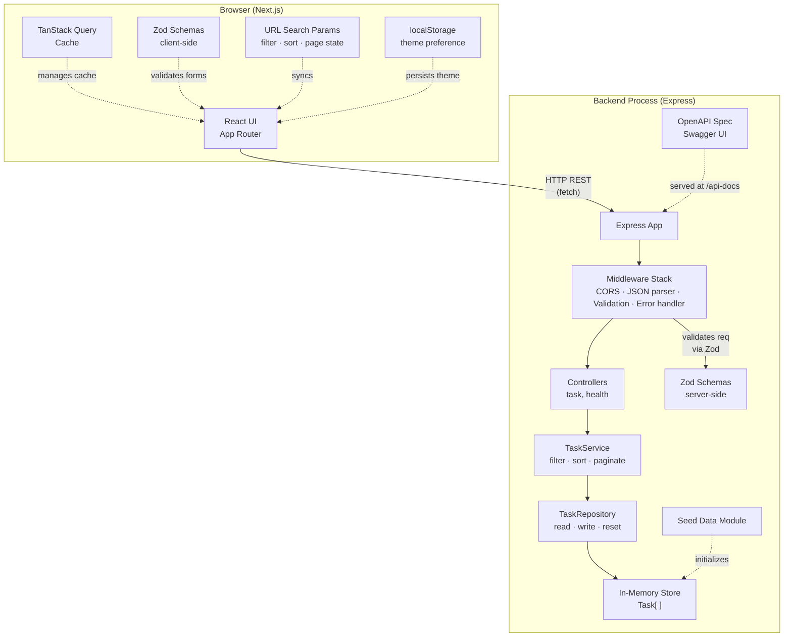
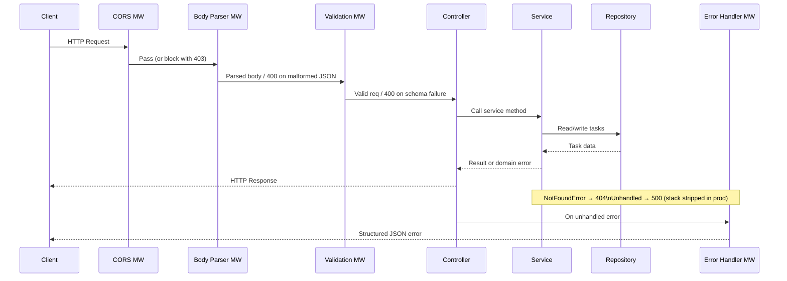
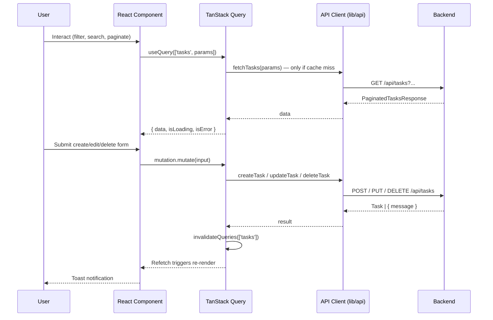

# Design Document: Task Management System

## Overview

The Task Management System is a full-stack SaaS-style monorepo application for creating, organizing, and tracking tasks. The frontend is a Next.js 14 (App Router) application using React and TypeScript. The backend is a Node.js Express REST API, also TypeScript. All task data lives exclusively in backend process memory — no database, no browser persistence, no external storage of any kind.

The system delivers a polished, production-quality experience with Kanban and list/table views, debounced search, composable filters, sort and pagination controls, drag-and-drop status updates, light/dark themes, and comprehensive accessibility support (focus management, ARIA roles, keyboard navigation, focus traps).

**Technology Stack**

| Layer | Technologies |
|-------|-------------|
| Frontend | Next.js 14 (App Router), React 18, TypeScript 5, Tailwind CSS, shadcn/ui, Lucide icons |
| Data fetching | TanStack Query v5 |
| Forms | React Hook Form v7, Zod v3 |
| Drag-and-drop | @dnd-kit/core |
| Backend | Node.js 20, Express 4, TypeScript 5 |
| Backend validation | Zod v3 |
| API docs | swagger-jsdoc + swagger-ui-express, OpenAPI 3.x |
| Testing | Vitest + Supertest (backend), Vitest + React Testing Library (frontend) |

---

## Architecture

### Monorepo Layout

```
task-management/
├── frontend/                         # Next.js 14 + React + TypeScript
│   ├── src/
│   │   ├── app/                      # App Router routes and root layout
│   │   │   ├── layout.tsx            # Root layout: QueryClient, ThemeProvider, shell
│   │   │   ├── page.tsx              # Redirect → /overview
│   │   │   ├── overview/page.tsx     # Dashboard
│   │   │   ├── tasks/page.tsx        # All Tasks (list/table view)
│   │   │   ├── board/page.tsx        # Kanban board
│   │   │   └── settings/page.tsx     # Settings
│   │   ├── components/
│   │   │   ├── shell/                # AppShell, Sidebar, TopBar, DrawerMenu
│   │   │   └── ui/                   # shadcn/ui re-exports and primitives
│   │   ├── features/tasks/
│   │   │   ├── components/           # Task-specific UI (see Components section)
│   │   │   └── hooks/                # TanStack Query hooks
│   │   ├── lib/
│   │   │   ├── api/                  # Typed fetch wrappers
│   │   │   └── validation/           # Zod schemas (client-side)
│   │   └── providers/                # QueryClientProvider, ThemeProvider
│   ├── .env.example
│   └── package.json
├── backend/                          # Node.js + Express + TypeScript
│   ├── src/
│   │   ├── routes/                   # Express Router definitions
│   │   ├── controllers/              # HTTP request/response handlers
│   │   ├── services/                 # Business logic (filter, sort, paginate)
│   │   ├── repositories/             # In-memory store + seed data
│   │   ├── validation/               # Zod schemas (server-side)
│   │   ├── middleware/               # CORS, body parser, validation, error handler
│   │   ├── types/                    # Shared TypeScript interfaces
│   │   ├── app.ts                    # Express app factory
│   │   └── server.ts                 # HTTP server entry point
│   ├── .env.example
│   └── package.json
├── docs/
│   └── openapi.yaml                  # OpenAPI 3.x specification
├── .gitignore
└── README.md
```

### System Architecture



### Backend Request Lifecycle



### Frontend Data Flow



---

## Components and Interfaces

### Backend Components

#### Repository — `src/repositories/taskRepository.ts`

The repository is the single source of truth for all in-memory task data. It owns a module-level `Task[]` array initialized from the seed data module at process startup.

**Design decision — factory pattern**: The repository is exposed as a factory function (`createTaskRepository`) rather than a singleton with module-level state. This makes the store easily reset per-test without restarting the process, satisfying the test-isolation requirement (Req 25.8). The default export (`taskRepository`) is the singleton used by the running application.

```typescript
export interface TaskRepository {
  findAll(): Task[];
  findById(id: string): Task | undefined;
  create(input: CreateTaskInput): Task;
  update(id: string, input: UpdateTaskInput): Task | undefined;
  delete(id: string): boolean;
  reset(tasks?: Task[]): void;   // restores store to initial state; used in tests
}

export function createTaskRepository(initial?: Task[]): TaskRepository;
export const taskRepository: TaskRepository;   // singleton (uses seed data)
```

ID generation uses `crypto.randomUUID()` (Node built-in, no extra dependencies) producing RFC 4122 v4 UUIDs — unique and not derivable from prior values (Req 2.2).

#### Service — `src/services/taskService.ts`

The service layer applies business logic: filtering, sorting, pagination, and domain error creation. It never touches HTTP.

```typescript
export interface TaskService {
  listTasks(params: ListTasksParams): PaginatedTasksResponse;
  getTask(id: string): Task;                     // throws NotFoundError
  createTask(input: CreateTaskDto): Task;
  updateTask(id: string, input: UpdateTaskDto): Task; // throws NotFoundError
  deleteTask(id: string): void;                  // throws NotFoundError
}

export interface ListTasksParams {
  search?:    string;
  status?:    TaskStatus;
  priority?:  TaskPriority;
  sortBy?:    'createdAt' | 'dueDate' | 'priority' | 'title';
  sortOrder?: 'asc' | 'desc';
  page?:      number;    // default 1
  pageSize?:  number;    // default 25
}
```

**In-memory filter → sort → paginate pipeline** (executes in this order):

```
allTasks = repository.findAll()

1. search  → keep tasks where title or description contains query (case-insensitive)
2. status  → keep tasks where task.status === filter.status
3. priority→ keep tasks where task.priority === filter.priority
4. sort    → stable sort by sortBy field (priority uses numeric weight map)
5. total   = filteredAndSorted.length
6. page    → slice((page-1)*pageSize, page*pageSize)

return { data: slice, total, page, pageSize }
```

Priority sort weight: `{ low: 0, medium: 1, high: 2 }`.
Default sort: `createdAt desc`.

#### Controller — `src/controllers/taskController.ts`

Controllers are deliberately thin: extract validated parameters, call the service, set the HTTP status, and serialize the response. No business logic lives here.

```typescript
// Route handler signatures
listTasks(req: Request, res: Response): Promise<void>
getTask(req: Request, res: Response): Promise<void>
createTask(req: Request, res: Response): Promise<void>
updateTask(req: Request, res: Response): Promise<void>
deleteTask(req: Request, res: Response): Promise<void>
healthCheck(req: Request, res: Response): void
```

#### Validation Schemas — `src/validation/taskSchemas.ts`

All request shapes are validated with Zod. Middleware parses `req.body` or `req.query` against the appropriate schema before the request reaches a controller.

```typescript
export const CreateTaskSchema = z.object({
  title:       z.string().trim().min(1, 'Title is required').max(255),
  description: z.string().trim().min(1, 'Description is required').max(1000),
  status:      z.enum(['pending', 'in_progress', 'completed']).default('pending'),
  priority:    z.enum(['low', 'medium', 'high']).default('medium'),
  dueDate:     z
    .string()
    .regex(/^\d{4}-\d{2}-\d{2}$/, 'dueDate must be YYYY-MM-DD')
    .refine(isValidCalendarDate, 'dueDate is not a valid calendar date')
    .nullable()
    .optional(),
});

export const UpdateTaskSchema = z.object({
  title:       z.string().trim().min(1).max(255),
  description: z.string().trim().min(1).max(1000),
  status:      z.enum(['pending', 'in_progress', 'completed']),
  priority:    z.enum(['low', 'medium', 'high']),
  dueDate:     z
    .string()
    .regex(/^\d{4}-\d{2}-\d{2}$/)
    .refine(isValidCalendarDate)
    .nullable()
    .optional(),
});

export const ListTasksQuerySchema = z.object({
  search:    z.string().optional(),
  status:    z.enum(['pending', 'in_progress', 'completed']).optional(),
  priority:  z.enum(['low', 'medium', 'high']).optional(),
  sortBy:    z.enum(['createdAt', 'dueDate', 'priority', 'title']).optional(),
  sortOrder: z.enum(['asc', 'desc']).optional(),
  page:      z.coerce.number().int().min(1).optional(),
  pageSize:  z.coerce.number().int().min(1).max(100).optional(),
});
```

**Validation error shape** returned on HTTP 400:

```json
{
  "message": "Validation failed",
  "errors": {
    "title": "Title is required",
    "dueDate": "dueDate must be YYYY-MM-DD"
  }
}
```

#### Middleware Stack — `src/middleware/`

| File | Purpose | When applied |
|------|---------|-------------|
| `cors.ts` | Allow origin from `FRONTEND_URL` env var | All routes |
| `bodyParser.ts` | Parse `application/json`; 400 on malformed JSON | All routes |
| `validateBody.ts` | Zod-parse `req.body` against supplied schema | POST/PUT routes |
| `validateQuery.ts` | Zod-parse `req.query` against supplied schema | GET /api/tasks |
| `notFound.ts` | 404 catch-all for unmatched routes | End of router chain |
| `errorHandler.ts` | Map domain errors + unknown errors to HTTP responses | End of app chain |

`errorHandler.ts` maps error types:

```typescript
if (err instanceof NotFoundError)    → 404
if (err instanceof ValidationError)  → 400
if (err instanceof SyntaxError && err.status === 400) → 400 (malformed JSON)
else                                 → 500 (stack stripped when NODE_ENV=production)
```

#### Seed Data — `src/repositories/seedData.ts`

A dedicated module (separate from repository logic) exporting `SEED_TASKS: Task[]`. Contains at least 5 pre-constructed tasks covering:
- One task per status: `pending`, `in_progress`, `completed`
- One task per priority: `low`, `medium`, `high`
- One task with a past `dueDate`
- One task with a future `dueDate`
- One task with `dueDate: null`

Seed data is controlled by the `SEED_DATA` env var (`'false'` disables it). The repository checks this at module initialization without touching seed-data parsing logic.

#### Routes — `src/routes/taskRoutes.ts`

```
GET    /api/health            → healthController.healthCheck
GET    /api/tasks             → validateQuery(ListTasksQuerySchema) → taskController.listTasks
POST   /api/tasks             → validateBody(CreateTaskSchema) → taskController.createTask
GET    /api/tasks/:id         → taskController.getTask
PUT    /api/tasks/:id         → validateBody(UpdateTaskSchema) → taskController.updateTask
DELETE /api/tasks/:id         → taskController.deleteTask
GET    /api-docs              → swagger-ui-express (dev mode)
```

---

### Frontend Components

#### Application Shell — `src/components/shell/`

```
AppShell (wraps every page via root layout)
├── Sidebar  (visible at ≥768 px)
│   ├── BrandLogo + ProductName
│   └── NavLink × 4  [Overview | All Tasks | Board | Settings]
│       └── active indicator via usePathname()
├── DrawerMenu  (visible at <768 px)
│   ├── HamburgerToggle (in TopBar)
│   └── Overlay + slide-in panel with same NavLinks
└── TopBar
    ├── PageTitle  (from page metadata / route segment)
    ├── GlobalSearchInput  (debounced 300 ms, updates URL ?search=)
    ├── ThemeToggle  (moon/sun icon, aria-label, calls toggleTheme())
    └── CreateTaskButton  (opens TaskFormDialog in create mode)
```

**Focus management in Drawer**: on open, focus moves to first NavLink; Tab/Shift-Tab cycle inside; Escape closes; focus returns to toggle button.

#### Task Feature Components — `src/features/tasks/components/`

| Component | Responsibility |
|-----------|----------------|
| `TaskTable` | Sortable, paginated table; columns: title, description (truncated ≤100 chars), status badge, priority badge, due date, actions |
| `TaskTableRow` | One row; edit / view / delete action buttons (icon-only with `aria-label`) |
| `KanbanBoard` | `DndContext` wrapper; renders three `KanbanColumn` components |
| `KanbanColumn` | `useDroppable`; displays column header + list of `KanbanCard`; shows empty-state with Create CTA |
| `KanbanCard` | `useDraggable`; shows title, priority chip, due date |
| `TaskForm` | React Hook Form + `taskFormSchema`; shared by create and edit flows |
| `TaskFormDialog` | Modal wrapper (`role="dialog"`, `aria-labelledby`); focus trap; Escape closes |
| `DeleteConfirmDialog` | Confirmation modal naming the task; disables confirm button while delete in flight |
| `TaskDetailView` | Read-only modal with full untruncated fields + formatted timestamps |
| `FilterBar` | Status and priority `<select>` dropdowns; active-filter indicator |
| `SortControls` | Four sort-field buttons; active field + direction visually indicated |
| `PaginationControls` | Prev / page-number buttons / Next; page-size selector (10 / 25 / 50) |
| `ActiveFilterBadge` | Appears when any filter or search is active; clicking clears all |
| `OverdueLabel` | Text + icon indicator (not color-only); shown when dueDate < today and status ≠ completed |
| `DueSoonLabel` | Text + icon indicator; shown when dueDate within 48 hours and status ≠ completed |

#### TanStack Query Hooks — `src/features/tasks/hooks/`

```typescript
// Query key factory (ensures coherent invalidation)
export const taskKeys = {
  all:    () => ['tasks'] as const,
  lists:  () => ['tasks', 'list'] as const,
  list:   (params: ListTasksParams) => ['tasks', 'list', params] as const,
  detail: (id: string) => ['tasks', 'detail', id] as const,
};

// useTaskList: subscribes to a filtered/sorted/paginated list
export function useTaskList(params: ListTasksParams): UseQueryResult<PaginatedTasksResponse>

// useTask: subscribes to a single task
export function useTask(id: string): UseQueryResult<Task>

// useCreateTask: POST mutation; on success invalidates taskKeys.lists()
export function useCreateTask(): UseMutationResult<Task, ApiError, CreateTaskDto>

// useUpdateTask: PUT mutation; on success invalidates taskKeys.lists() + taskKeys.detail(id)
export function useUpdateTask(): UseMutationResult<Task, ApiError, { id: string; input: UpdateTaskDto }>

// useDeleteTask: DELETE mutation; on success invalidates taskKeys.lists()
export function useDeleteTask(): UseMutationResult<void, ApiError, string>
```

**Stale time**: list queries use `staleTime: 30_000` (30 s) to avoid refetching on every keystroke; individual task queries use `staleTime: 60_000`.

#### URL State Hook — `src/features/tasks/hooks/useTaskFilters.ts`

Reads and writes all filter/sort/pagination params via Next.js `useSearchParams` + `useRouter`. Provides typed getters and setters. On any filter/sort change, resets `page` to 1. Returns a serialized `ListTasksParams` object ready for the TanStack Query key and API call.

```typescript
export interface UseTaskFiltersReturn {
  params: ListTasksParams;
  setSearch(v: string): void;
  setStatus(v: TaskStatus | undefined): void;
  setPriority(v: TaskPriority | undefined): void;
  setSortBy(v: SortField): void;           // toggles direction if same field selected
  setPage(v: number): void;
  setPageSize(v: number): void;
  clearAll(): void;
  isFiltered: boolean;    // true when any non-default filter is active
}
```

#### API Client — `src/lib/api/tasks.ts`

```typescript
const BASE = process.env.NEXT_PUBLIC_API_URL;   // e.g. "http://localhost:3001"

export class ApiError extends Error {
  constructor(public status: number, message: string, public errors?: Record<string, string>) {
    super(message);
  }
}

async function request<T>(path: string, init?: RequestInit): Promise<T> {
  const res = await fetch(`${BASE}${path}`, init);
  if (!res.ok) {
    const body = await res.json().catch(() => ({ message: 'Unknown error' }));
    throw new ApiError(res.status, body.message, body.errors);
  }
  return res.json() as T;
}

export const tasksApi = {
  list:   (params: ListTasksParams) => request<PaginatedTasksResponse>(`/api/tasks?${toQueryString(params)}`),
  get:    (id: string) => request<Task>(`/api/tasks/${id}`),
  create: (dto: CreateTaskDto) => request<Task>('/api/tasks', { method: 'POST', body: JSON.stringify(dto), headers: { 'Content-Type': 'application/json' } }),
  update: (id: string, dto: UpdateTaskDto) => request<Task>(`/api/tasks/${id}`, { method: 'PUT', body: JSON.stringify(dto), headers: { 'Content-Type': 'application/json' } }),
  delete: (id: string) => request<{ message: string }>(`/api/tasks/${id}`, { method: 'DELETE' }),
};
```

#### Client Validation — `src/lib/validation/taskSchema.ts`

```typescript
export const taskFormSchema = z.object({
  title: z
    .string()
    .trim()
    .min(1, 'Title is required')
    .max(255, 'Title must be 255 characters or fewer'),
  description: z
    .string()
    .trim()
    .min(1, 'Description is required')
    .max(1000, 'Description must be 1000 characters or fewer'),
  status:   z.enum(['pending', 'in_progress', 'completed']),
  priority: z.enum(['low', 'medium', 'high']),
  dueDate: z
    .string()
    .regex(/^\d{4}-\d{2}-\d{2}$/, 'Use YYYY-MM-DD format')
    .refine(isValidCalendarDate, 'Invalid calendar date (e.g. Feb 30 is not valid)')
    .nullable()
    .optional(),
});

export type TaskFormValues = z.infer<typeof taskFormSchema>;
```

> **Design note — description max length discrepancy**: Requirement 2.1 specifies the Task data model allows descriptions up to 1000 characters, while Requirement 20.4 specifies a client-side maximum of 2000 characters. The design aligns both client and server validation to **1000 characters** so client-side errors mirror backend behavior. Teams should update Requirement 20.4 to match.

#### Theme Provider — `src/providers/ThemeProvider.tsx`

```typescript
type Theme = 'light' | 'dark';
interface ThemeContextValue { theme: Theme; toggleTheme(): void; }

// On mount (useEffect):
//   1. Read localStorage.getItem('theme')
//   2. Fall back to window.matchMedia('(prefers-color-scheme: dark)').matches
//   3. Apply 'dark' class to document.documentElement for Tailwind

// On toggle:
//   1. Flip theme
//   2. Write to localStorage (catch block for unavailable storage)
//   3. Update <html class="">
```

`prefers-reduced-motion` is handled at the Tailwind level via a `motion-safe:` variant applied to all transition utilities — no JavaScript required.

#### Kanban Drag-and-Drop — `src/features/tasks/components/KanbanBoard.tsx`

```typescript
// Uses @dnd-kit/core
<DndContext
  sensors={sensors}   // PointerSensor + KeyboardSensor for accessibility
  onDragEnd={handleDragEnd}
>
  {COLUMNS.map(col => (
    <KanbanColumn key={col.status} status={col.status} tasks={tasksByStatus[col.status]} />
  ))}
</DndContext>
```

`handleDragEnd` logic:

```typescript
async function handleDragEnd({ active, over }: DragEndEvent) {
  if (!over || active.id === over.id) return;  // same column or no target
  
  const taskId = active.id as string;
  const newStatus = over.id as TaskStatus;     // droppable id === column status
  const oldStatus = getTaskStatus(taskId);
  
  if (newStatus === oldStatus) return;          // Req 15.6: no-op on same column
  
  // Optimistic update
  setOptimisticStatus(taskId, newStatus);
  
  try {
    await updateTask.mutateAsync({ id: taskId, input: { ...task, status: newStatus } });
  } catch {
    setOptimisticStatus(taskId, oldStatus);    // Req 15.3: revert on failure
    toast.error('Failed to update task status');
  }
}
```

---

## Data Models

### Core Task Type

```typescript
export type TaskStatus   = 'pending' | 'in_progress' | 'completed';
export type TaskPriority = 'low' | 'medium' | 'high';

export interface Task {
  id:          string;           // UUID v4, max 128 characters, server-generated
  title:       string;           // 1–255 characters (stored trimmed)
  description: string;           // 1–1000 characters (stored trimmed)
  status:      TaskStatus;
  priority:    TaskPriority;
  dueDate:     string | null;    // "YYYY-MM-DD" or null
  createdAt:   string;           // ISO 8601 timestamp e.g. "2025-01-15T10:30:00.000Z"
  updatedAt:   string;           // ISO 8601 timestamp; >= createdAt always
}
```

### Request / Response DTOs

```typescript
// POST /api/tasks body
export interface CreateTaskDto {
  title:        string;
  description:  string;
  status?:      TaskStatus;    // default: 'pending'
  priority?:    TaskPriority;  // default: 'medium'
  dueDate?:     string | null;
}

// PUT /api/tasks/:id body (full replacement, not patch)
export interface UpdateTaskDto {
  title:       string;
  description: string;
  status:      TaskStatus;
  priority:    TaskPriority;
  dueDate?:    string | null;
}

// GET /api/tasks response
export interface PaginatedTasksResponse {
  data:     Task[];
  total:    number;   // total matching tasks (before pagination)
  page:     number;
  pageSize: number;
}

// Error response (all 4xx / 5xx)
export interface ApiErrorBody {
  message: string;
  errors?: Record<string, string>;  // field → message; present on validation errors
}

// GET /api/health response
export interface HealthResponse {
  status: 'ok';
  timestamp: string;
}
```

### Priority Sort Weight

Used by `TaskService` when `sortBy === 'priority'`:

```typescript
const PRIORITY_WEIGHT: Record<TaskPriority, number> = {
  low: 0, medium: 1, high: 2,
};
```

### URL State Parameters (Frontend)

All list-view state is serialized to the URL query string. `useTaskFilters` reads/writes these keys:

| Key | Type | Default | Notes |
|-----|------|---------|-------|
| `search` | string | `''` | Omitted from URL when empty |
| `status` | `'all'` \| TaskStatus | `'all'` | Omitted when `'all'` |
| `priority` | `'all'` \| TaskPriority | `'all'` | Omitted when `'all'` |
| `sortBy` | SortField | `'createdAt'` | |
| `sortOrder` | `'asc'` \| `'desc'` | `'desc'` | |
| `page` | number | `1` | Reset to 1 on filter/sort change |
| `pageSize` | number | `25` | |

### Date Handling

- **Storage**: `createdAt`, `updatedAt` are stored as full ISO 8601 strings (UTC). `dueDate` is stored as `"YYYY-MM-DD"` strings or `null`.
- **Display (list/table)**: `Jan 15, 2025` — formatted with `Intl.DateTimeFormat('en-US', { month: 'short', day: 'numeric', year: 'numeric' })`.
- **Display (detail view)**: `Jan 15, 2025, 10:30 AM` — formatted including hour and minute.
- **Overdue check**: `dueDate` string is parsed as a local date at midnight; compared against `new Date()` with time stripped. Tasks with no `dueDate` are never overdue.
- **Due-soon check**: `dueDate` is within the next 48 hours from now.

### Environment Variables

**Backend `.env.example`**:
```
PORT=3001
FRONTEND_URL=http://localhost:3000
NODE_ENV=development
SEED_DATA=true
```

**Frontend `.env.example`**:
```
NEXT_PUBLIC_API_URL=http://localhost:3001
```

---

## Correctness Properties

*A property is a characteristic or behavior that should hold true across all valid executions of a system — essentially, a formal statement about what the system should do. Properties serve as the bridge between human-readable specifications and machine-verifiable correctness guarantees.*

---

### Property 1: Task ID Uniqueness

*For any* sequence of create-task operations, the `id` values assigned to the resulting tasks are pairwise distinct — no two tasks share the same `id`.

**Validates: Requirements 2.2**

---

### Property 2: Timestamp Invariant

*For any* task, at all points in its lifecycle, `createdAt` is a valid ISO 8601 timestamp set at creation time, `updatedAt` is a valid ISO 8601 timestamp, and `updatedAt` is never earlier than `createdAt`. Specifically: immediately after creation, `createdAt === updatedAt`; after any subsequent update, the new `updatedAt` is ≥ the original `createdAt`.

**Validates: Requirements 2.3, 2.4**

---

### Property 3: Server-Generated Fields Override Client-Supplied Values

*For any* `POST /api/tasks` request body that includes `id`, `createdAt`, or `updatedAt` fields, the task persisted in the store has server-generated values for all three fields that are different from any values the client supplied.

**Validates: Requirements 2.5**

---

### Property 4: Search Filter Correctness

*For any* collection of tasks in the store and *for any* non-empty search string `q`, every task returned by `GET /api/tasks?search=q` has its `title` or `description` containing `q` as a case-insensitive substring; and no task in the store whose `title` and `description` both contain `q` (case-insensitive) is absent from the response.

**Validates: Requirements 4.2**

---

### Property 5: Status and Priority Filter Correctness

*For any* collection of tasks and *for any* valid `status` or `priority` filter value, every task in the filtered response matches the requested value exactly; no task that fails the filter criterion appears in the response; and no task that satisfies the criterion is omitted.

**Validates: Requirements 4.3, 4.4**

---

### Property 6: Sort Ordering Invariant

*For any* collection of tasks, *for any* valid `sortBy` field (`createdAt`, `dueDate`, `priority`, `title`), and *for any* sort direction (`asc` or `desc`), every adjacent pair of tasks in the response satisfies the expected ordering relation for the requested field and direction. Tasks with equal sort-key values maintain a consistent relative order (stable sort).

**Validates: Requirements 4.5, 4.6**

---

### Property 7: Pagination Slice Correctness

*For any* collection of tasks, *for any* valid `page` ≥ 1 and `pageSize` between 1 and 100, the `data` array in the paginated response contains exactly the tasks at positions `(page−1)×pageSize` through `page×pageSize−1` of the fully filtered and sorted collection; `total` equals the count of all matching tasks before pagination; and the response `page` and `pageSize` echo the requested values.

**Validates: Requirements 4.7, 14.1, 14.2**

---

### Property 8: Whitespace-Only Input Rejected by Both Validators

*For any* string composed entirely of whitespace characters (including the empty string), submitting it as `title` or `description` in a POST or PUT request is rejected by the server validator with HTTP 400 and a field-level error message; and the same input, when validated by the client-side Zod schema, produces a validation failure for that field.

**Validates: Requirements 7.1, 7.2, 20.3, 20.4**

---

### Property 9: Invalid Enum Values Rejected

*For any* string that is not a member of `{ 'pending', 'in_progress', 'completed' }` supplied as `status`, or *for any* string that is not a member of `{ 'low', 'medium', 'high' }` supplied as `priority`, both the server-side Zod validator and the client-side Zod schema reject the input with a field-level error identifying the invalid value and listing valid options.

**Validates: Requirements 7.3, 7.4, 20.5, 20.6**

---

### Property 10: Invalid Calendar Dates Rejected

*For any* string that is either not in `YYYY-MM-DD` format or represents a logically invalid calendar date (e.g., February 30, month 13, day 0), both the server-side and client-side validators reject it with a field-level error. *For any* string that represents a valid `YYYY-MM-DD` calendar date, both validators accept it.

**Validates: Requirements 7.5, 20.7**

---

### Property 11: Stored Strings Are Always Trimmed

*For any* `title` or `description` value submitted with leading or trailing whitespace, the task persisted in the store has `title` and `description` values with no leading or trailing whitespace (i.e., `stored.title === submitted.title.trim()`).

**Validates: Requirements 7.7**

---

### Property 12: Composed Filters Satisfy All Active Criteria Simultaneously

*For any* collection of tasks and *for any* combination of active `search`, `status`, and `priority` parameters in a single `GET /api/tasks` request, every task in the response simultaneously satisfies all active filter criteria — no partial matching is acceptable.

**Validates: Requirements 4.2, 4.3, 4.4, 13.6**

---

## Error Handling

### Backend Error Taxonomy

| Error Type | HTTP Status | When Thrown |
|-----------|-------------|-------------|
| `NotFoundError` | 404 | Task ID does not exist in the store |
| `ValidationError` (Zod) | 400 | Request body or query fails Zod schema |
| `SyntaxError` (body-parser) | 400 | Malformed JSON in request body |
| Unhandled Error | 500 | Any unexpected runtime error |

**Production mode**: Error middleware strips `stack` from the response body when `NODE_ENV === 'production'`. The full error (including stack) is written to `console.error` for log capture.

**Error response format** (all error responses share this shape):

```json
{
  "message": "Validation failed",
  "errors": {
    "title": "Title is required",
    "dueDate": "dueDate must be YYYY-MM-DD"
  }
}
```

`errors` is present only on 400 validation responses; it is absent on 404 and 500 responses.

### Frontend Error Handling Strategy

| Scenario | User-visible outcome |
|---------|----------------------|
| List/detail fetch fails | Skeleton replaced with error message + Retry button |
| Create/edit/delete mutation fails (network) | Error Toast (≥3 s), form stays open, submit re-enabled |
| Create fails with HTTP 400 | Field-level errors shown inline; form stays open |
| Edit fails with HTTP 400 | Field-level errors shown inline; form stays open |
| Delete fails with HTTP 404 | Error Toast (≥3 s) + task list refreshed from API |
| Delete fails (other) | Error Toast (≥3 s); task remains in displayed list |
| Kanban drag-drop PUT fails | Task card reverted to original column; error Toast |
| Backend unreachable | "Service unavailable" message with Retry action |
| Successful mutation | Success Toast (≥5 s), shown only after API confirms |

**Toast implementation**: Uses shadcn/ui `Sonner` or `useToast` hook. All toasts are non-blocking and positioned at bottom-right. Error toasts use a distinct visual treatment (not color-only — icon + text label).

**Retry behavior**: The Retry button in error states calls `refetch()` from the TanStack Query `useQueryResult`. For mutations, the user retriggers the action manually.

### Accessibility in Error States

- Error messages are associated with their form fields via `aria-describedby`.
- Toast notifications use `role="status"` (success) and `role="alert"` (error) so screen readers announce them.
- The Retry button in error banners receives focus when the error state is rendered (via `useEffect` + `ref.focus()`).

---

## Testing Strategy

### Overview

The project uses a dual testing approach: example-based unit/integration tests for specific behaviors and concrete flows, and property-based tests for universal invariants. Both are necessary and complementary. The property-based testing library is **fast-check** (TypeScript-native, excellent developer experience, used for both frontend and backend).

### Backend Testing — Vitest + Supertest + fast-check

**Setup**: Each backend test file imports a fresh `createTaskRepository()` instance and injects it into `createTaskService()`. The Express `app` is created from `createApp(service)` — a factory function that accepts the service as a dependency, making every test start with a clean store.

```typescript
// backend/src/test/helpers.ts
export function createTestApp() {
  const repo = createTaskRepository([]);       // empty store
  const service = createTaskService(repo);
  return { app: createApp(service), repo, service };
}
```

**Unit tests (Vitest)** — `src/services/taskService.test.ts`, `src/validation/taskSchemas.test.ts`:

| Test group | What it verifies |
|-----------|-----------------|
| `listTasks` — empty store | Returns `{ data: [], total: 0 }` |
| `listTasks` — with tasks | Returns all tasks |
| `listTasks` — search | Only matching tasks returned |
| `listTasks` — status filter | Only matching tasks returned |
| `listTasks` — priority filter | Only matching tasks returned |
| `listTasks` — sort by createdAt | Correct order |
| `listTasks` — pagination | Correct slice and metadata |
| `createTask` | Returns task with server-generated id/timestamps |
| `createTask` — id/createdAt/updatedAt in body | Fields ignored |
| `getTask` — found | Returns task |
| `getTask` — not found | Throws NotFoundError |
| `updateTask` — found, valid | Returns updated task with new updatedAt |
| `updateTask` — not found | Throws NotFoundError |
| `deleteTask` — found | Removes task |
| `deleteTask` — not found | Throws NotFoundError |

**Integration tests (Vitest + Supertest)** — `src/routes/tasks.test.ts`:

These tests match Requirement 25 exactly:

- `POST /api/tasks` with valid data → 201 with all required fields (Req 25.1)
- `GET /api/tasks` → 200 with array; empty store → empty array (Req 25.2)
- `GET /api/tasks/:id` existing → 200 with matching fields (Req 25.3)
- `GET /api/tasks/:id` not found → 404 with JSON error (Req 25.4)
- `POST /api/tasks` missing fields → 400 with per-field errors (Req 25.5)
- `PUT /api/tasks/:id` valid → 200 with updated values (Req 25.6)
- `DELETE /api/tasks/:id` → 200; subsequent GET → 404 (Req 25.7)
- `PUT /api/tasks/:id` not found → 404 (Req 25.10)
- `DELETE /api/tasks/:id` not found → 404 (Req 25.11)
- `GET /api/health` → 200 with `{ status: 'ok' }` (Req 6.1)
- Unknown route → 404 (Req 6.2)
- Malformed JSON body → 400 (Req 6.8)

**Property-based tests (Vitest + fast-check)** — `src/services/taskService.property.test.ts`:

Each property test runs a **minimum of 100 iterations** with fast-check's `fc.assert(fc.property(...))`.

Tag format for each test: `// Feature: task-management-system, Property N: <property_text>`

| Test | Property validated |
|-----|---------------------|
| ID uniqueness across N creates | Property 1 |
| Timestamp invariant after create + update | Property 2 |
| Server ignores client id/createdAt/updatedAt | Property 3 |
| Search returns only and all matching tasks | Property 4 |
| Status + priority filters include/exclude correctly | Property 5 |
| Sort produces non-decreasing/non-increasing sequences | Property 6 |
| Pagination returns correct slice + accurate metadata | Property 7 |
| Whitespace titles/descriptions are rejected | Property 8 |
| Invalid enum values produce 400 with field errors | Property 9 |
| Invalid calendar dates are rejected; valid dates accepted | Property 10 |
| Stored title/description are trimmed | Property 11 |
| Combined filters satisfy all criteria simultaneously | Property 12 |

**fast-check generators used**:

```typescript
// Task content generators
const titleArb       = fc.string({ minLength: 1, maxLength: 255 }).filter(s => s.trim().length > 0);
const descriptionArb = fc.string({ minLength: 1, maxLength: 1000 }).filter(s => s.trim().length > 0);
const statusArb      = fc.constantFrom('pending', 'in_progress', 'completed');
const priorityArb    = fc.constantFrom('low', 'medium', 'high');
const dueDateArb     = fc.option(fc.date({ min: new Date('2020-01-01'), max: new Date('2030-12-31') })
                         .map(d => d.toISOString().slice(0, 10)));

const createDtoArb = fc.record({ title: titleArb, description: descriptionArb,
                                  status: statusArb, priority: priorityArb, dueDate: dueDateArb });
const taskCollectionArb = fc.array(createDtoArb, { minLength: 0, maxLength: 50 });

// Invalid input generators
const whitespaceArb      = fc.stringOf(fc.constantFrom(' ', '\t', '\n', '\r'));
const invalidStatusArb   = fc.string().filter(s => !['pending','in_progress','completed'].includes(s));
const invalidPriorityArb = fc.string().filter(s => !['low','medium','high'].includes(s));
const invalidDateArb     = fc.oneof(
  fc.string().filter(s => !/^\d{4}-\d{2}-\d{2}$/.test(s)),
  fc.tuple(fc.integer({min:1,max:9999}), fc.integer({min:1,max:12}), fc.integer({min:29,max:31}))
    .map(([y,m,d]) => `${y.toString().padStart(4,'0')}-${m.toString().padStart(2,'0')}-${d.toString().padStart(2,'0')}`)
    .filter(s => isNaN(new Date(s).getTime()))
);
```

### Frontend Testing — Vitest + React Testing Library

**Unit tests** — `src/lib/validation/taskSchema.test.ts`:

Tests the Zod `taskFormSchema` directly as a pure function:
- Empty and whitespace titles/descriptions fail validation
- Titles ≤ 255 chars and descriptions ≤ 1000 chars pass
- Titles > 255 chars and descriptions > 1000 chars fail
- Valid YYYY-MM-DD dates pass; invalid calendar dates (Feb 30) fail
- Valid status and priority values pass; invalid values fail

**Component tests** — `src/features/tasks/components/*.test.tsx`:

Tests matching Requirement 26:

| Test | Requirement |
|-----|-------------|
| Whitespace-only title → validation error visible (Req 26.1) | 26.1 |
| Whitespace-only description → validation error visible (Req 26.2) | 26.2 |
| Pending API call → Skeleton loaders visible (Req 26.3) | 26.3 |
| Empty API response → empty state displayed (Req 26.4) | 26.4 |
| API error → error state + Retry button visible (Req 26.5) | 26.5 |
| Delete action triggered → confirmation dialog shown (Req 26.6) | 26.6 |
| Cancel delete → dialog dismissed, task still in list (Req 26.7) | 26.7 |

Additional component tests:
- Theme toggle applies `dark` class to `<html>` and persists to `localStorage`
- `useTaskFilters` resets page to 1 when any filter changes
- `useTaskFilters` clears all params on `clearAll()`
- Task detail view shows `'No due date'` when `dueDate` is null
- Overdue label shown for past-due, non-completed tasks
- Due-soon label shown for tasks due within 48 hours
- Success Toast appears only after API responds, not before

**Frontend property-based tests** — `src/lib/validation/taskSchema.property.test.ts`:

```typescript
// Feature: task-management-system, Property 8 (client): Whitespace rejected by Zod schema
fc.assert(fc.property(whitespaceArb, (s) => {
  const result = taskFormSchema.safeParse({ title: s, description: 'valid', ... });
  return result.success === false && result.error.issues.some(i => i.path[0] === 'title');
}), { numRuns: 100 });

// Feature: task-management-system, Property 10 (client): Invalid calendar dates rejected
fc.assert(fc.property(invalidDateArb, (s) => {
  const result = taskFormSchema.safeParse({ ..., dueDate: s });
  return result.success === false;
}), { numRuns: 100 });
```

### Test Configuration

**Backend `vitest.config.ts`**:
```typescript
export default defineConfig({
  test: {
    globals: true,
    environment: 'node',
    setupFiles: ['./src/test/setup.ts'],
  },
});
```

**Frontend `vitest.config.ts`**:
```typescript
export default defineConfig({
  plugins: [react()],
  test: {
    globals: true,
    environment: 'jsdom',
    setupFiles: ['./src/test/setup.ts'],
  },
});
```

**Scripts (both packages)**:
```json
{
  "scripts": {
    "dev":       "...",
    "build":     "tsc",
    "lint":      "eslint src --ext .ts,.tsx",
    "typecheck": "tsc --noEmit",
    "test":      "vitest run"
  }
}
```

All tests run in single-execution mode (`vitest run`) with no watch mode, matching Requirement 27.

### Test Coverage Goals

| Layer | Target |
|-------|--------|
| Backend service logic | All filter/sort/pagination combinations |
| Backend route integration | All endpoint × status-code combinations |
| Backend validation | All field rules (server-side) |
| Frontend Zod schema | All field rules (client-side) |
| Frontend component flows | All 7 flows in Req 26 + key UI states |
| Property tests | 12 universal properties × ≥100 iterations each |
